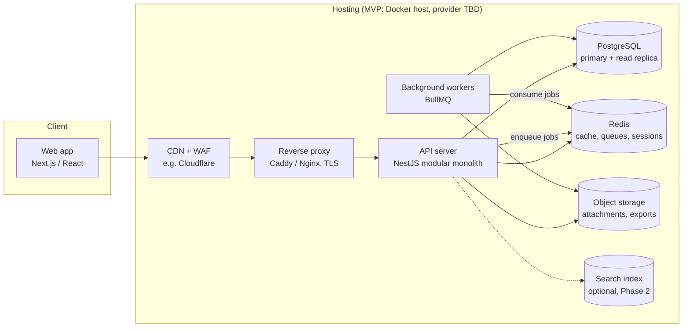
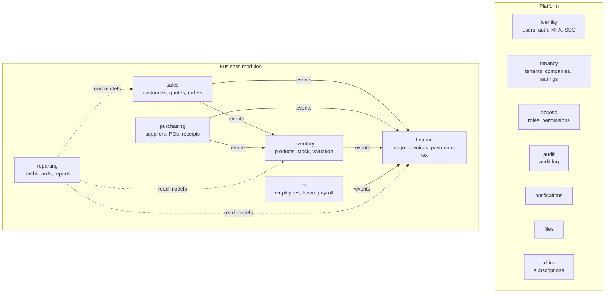
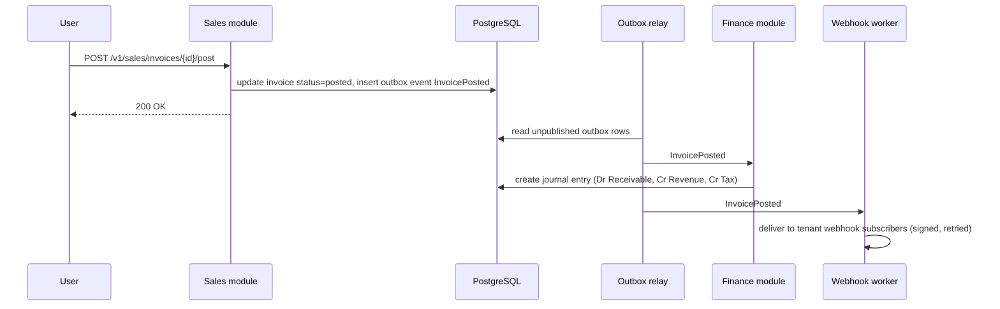

# System Architecture

> **Status:** Draft (proposed) · **Owner:** Tech Lead · **Audience:** Engineers, architects, DevOps, security, technical stakeholders
> The technology choices here are **proposals** recorded in [ADRs](adr/README.md). Change the ADR first, then this page.

## 1. Architecture at a glance

- **Style:** Modular monolith ([ADR-0001](adr/0001-modular-monolith.md)). One deployable backend, split internally into modules with strict boundaries, so modules can be extracted into services later.
- **Tenancy:** Shared database, shared schema, `tenant_id` on every row, enforced by PostgreSQL row-level security ([ADR-0002](adr/0002-multi-tenancy-strategy.md)).
- **Stack:** TypeScript end to end. Next.js frontend, NestJS backend, PostgreSQL, Redis, S3-compatible object storage ([ADR-0003](adr/0003-technology-stack.md)).
- **Hosting:** Docker containers on a provider-neutral host for the MVP, no AWS ([ADR-0005](adr/0005-mvp-hosting-without-aws.md)). A move to a larger cloud is planned only when scale requires it ([Infrastructure and deployment](05-infrastructure-and-deployment.md)).

## 2. Context diagram (C4 level 1)

```mermaid
flowchart TB
  user[Business users<br/>owner, finance, sales, warehouse, HR]
  admin[Tenant administrator]
  support[Our support team]
  ext[Customer's other systems<br/>e-commerce, BI, custom apps]

  erp[[ERP SaaS Platform]]

  email[Email provider]
  pay[Payment gateway]
  bank[Bank feeds]
  idp[Customer identity provider<br/>SAML / OIDC]

  user --> erp
  admin --> erp
  support --> erp
  ext <-->|REST API, webhooks| erp
  erp --> email
  erp <--> pay
  erp <-- bank
  erp <--> idp
```

## 3. Container diagram (C4 level 2)



| Container | Responsibility | Tech |
|---|---|---|
| Web app | UI, server-side rendering, calls the API | Next.js, React, TypeScript, TanStack Query, Tailwind |
| API server | Business logic, authentication, authorization, REST API | Node.js LTS, NestJS, TypeScript |
| Workers | Long-running and async jobs: reports, imports, emails, webhooks, payroll runs | NestJS + BullMQ |
| PostgreSQL | System of record | PostgreSQL 16, row-level security |
| Redis | Cache, job queues, rate limiting | Redis 7 |
| Object storage | Files: attachments, generated PDFs, exports | Any S3-compatible storage (MinIO self-hosted for MVP, or the host's object storage) |

## 4. Backend module structure (C4 level 3)

Each business module owns its tables, its domain logic and its public interface. Modules talk to each other only through:

1. **Public service interfaces** (synchronous, in-process calls), or
2. **Domain events** (asynchronous, via an in-process event bus backed by an outbox table).

A module **must not** query another module's tables directly. This rule is checked in CI with dependency rules ([Coding standards](../engineering/02-coding-standards.md#module-boundaries)).



### Layers inside a module

```
modules/<module>/
  api/            # REST controllers, request/response DTOs, validation
  application/    # use cases (commands and queries), transactions
  domain/         # entities, value objects, domain rules, domain events
  infrastructure/ # repositories, database mapping, external adapters
  <module>.module.ts
  index.ts        # the ONLY file other modules may import
```

## 5. Key flows

### 5.1 Request lifecycle

1. Request reaches CDN/WAF, then load balancer, then API.
2. Auth middleware validates the access token (JWT) or API key.
3. Tenant context is resolved from the token and set on the database connection (`SET app.tenant_id = ...`), so row-level security applies.
4. Permission guard checks the user's role allows the action.
5. Controller validates input and calls an application use case.
6. Use case runs inside a database transaction, writes domain changes, audit entries and outbox events in the **same transaction**.
7. Response returned. An outbox relay publishes events to queues for other modules, webhooks and notifications.

### 5.2 Posting a sales invoice (cross-module example)



## 6. Cross-cutting concerns

| Concern | Approach |
|---|---|
| Authentication | Email/password (Argon2id hashing), TOTP MFA, SAML/OIDC SSO; short-lived JWT access tokens + rotating refresh tokens |
| Authorization | RBAC: permissions like `finance.invoice.post`; roles bundle permissions; checked by guards and in use cases |
| Tenant isolation | `tenant_id` column + PostgreSQL RLS + tenant-scoped repositories + isolation tests |
| Auditing | Audit entries written in the same transaction as the change |
| Money | Stored as `numeric(19,4)` with currency code; never floating point |
| Time | Stored in UTC (`timestamptz`); displayed in tenant time zone |
| IDs | UUID v7 (time-ordered) primary keys |
| Idempotency | `Idempotency-Key` header on POST endpoints |
| Configuration | Environment variables, validated at startup; secrets injected from the host's secret store or an encrypted secrets file (never committed); a dedicated secrets manager later |
| Observability | OpenTelemetry traces, structured JSON logs, Prometheus-style metrics, request ID on every log line |
| Feature flags | Per tenant and per environment, for gradual rollout |
| Localization | i18n message catalogs on the frontend; locale-aware formatting |

## 7. Scalability path

| Stage | Tenants | Approach |
|---|---|---|
| Launch | 0–1,000 | One API service (auto-scaled), one PostgreSQL primary + replica |
| Growth | 1,000–5,000 | Read replicas for reports, caching, partition large tables by tenant/time |
| Scale | 5,000+ | Extract hot modules (e.g. reporting) into services; shard tenants across database clusters; dedicated databases for enterprise tenants |

## 8. Related documents

- [Data model](02-data-model.md)
- [API design](03-api-design.md)
- [Security and compliance](04-security-and-compliance.md)
- [Infrastructure and deployment](05-infrastructure-and-deployment.md)
- [Architecture Decision Records](adr/README.md)
