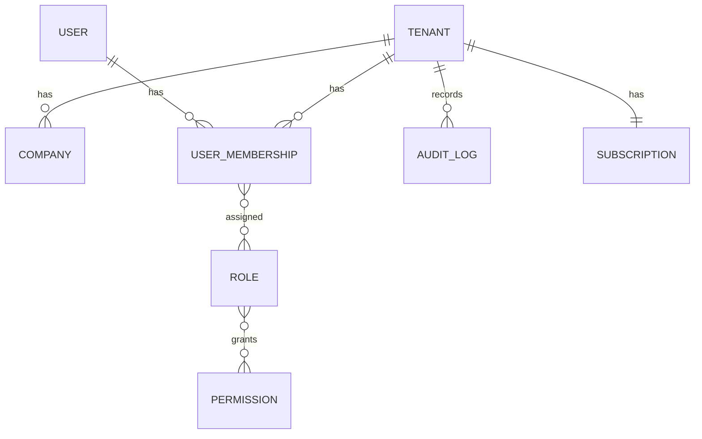
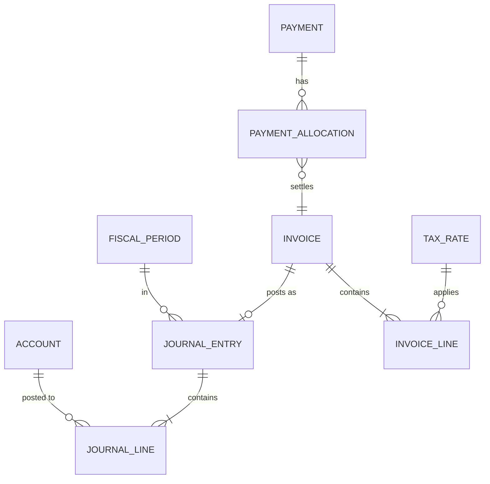
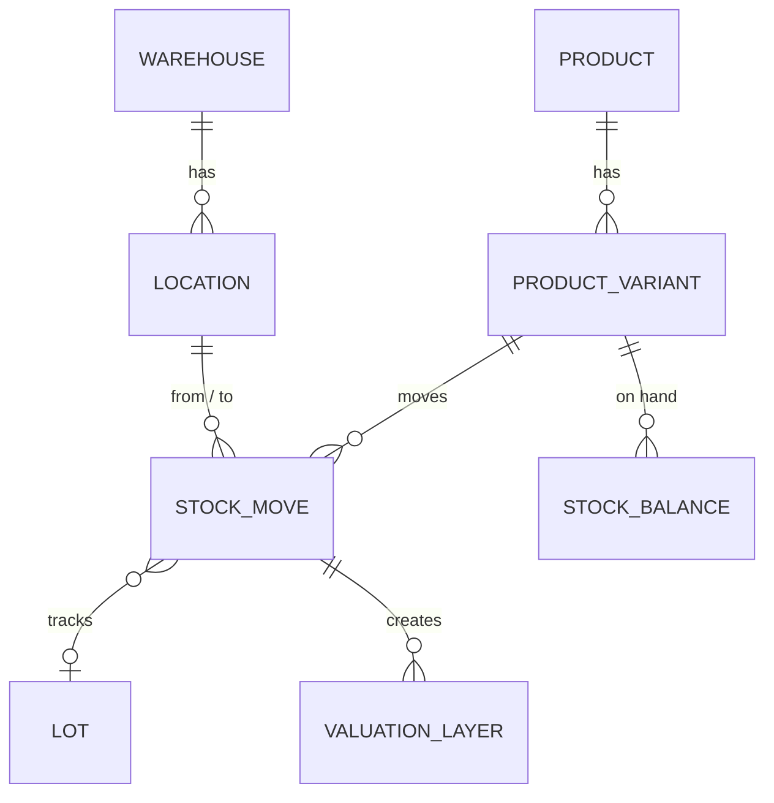
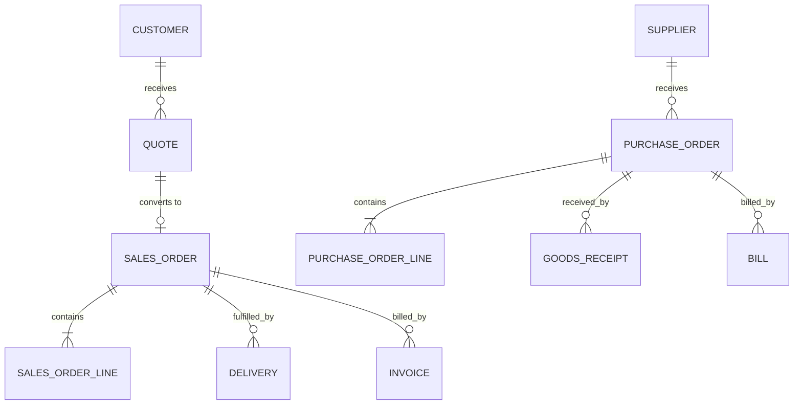

# Data Model

> **Status:** Draft (proposed) · **Owner:** Tech Lead · **Audience:** Backend engineers, data/BI, QA

This is the conceptual model. The migrations in the codebase are the source of truth once they exist.

## 1. Conventions

| Rule | Detail |
|---|---|
| Primary keys | `id uuid` (UUID v7) |
| Tenant column | Every tenant-owned table has `tenant_id uuid not null`, indexed, with an RLS policy |
| Timestamps | `created_at`, `updated_at` as `timestamptz` (UTC) |
| Actor columns | `created_by`, `updated_by` (user id) |
| Soft delete | `deleted_at` only for master data (customers, products). Transactions are never deleted; they are cancelled or reversed |
| Money | `numeric(19,4)` plus `currency char(3)` |
| Quantities | `numeric(19,6)` |
| Naming | `snake_case`, plural table names, prefixed by module schema: `finance.journal_entries` |
| Optimistic locking | `version integer` on editable records |

Each module owns a PostgreSQL **schema** (`core`, `finance`, `inventory`, `sales`, `purchasing`, `hr`).

## 2. Core entities

- **tenant**: the customer organization (billing unit).
- **company**: a legal entity inside a tenant (a tenant may have several).
- **user**: a person; can belong to several tenants via **user_membership**.
- **role / permission**: RBAC.
- **audit_log**: append-only, `entity_type, entity_id, action, before jsonb, after jsonb, actor_id, at`.

## 3. Finance

**Invariants (enforced in domain code and by database constraints/triggers):**
1. For every journal entry, sum of debits = sum of credits.
2. Posted entries are immutable. Corrections are made with reversing entries.
3. No posting into a locked fiscal period.
4. Every journal entry references its source document (`source_type`, `source_id`).

## 4. Inventory

- **stock_move** is the ledger of all stock changes; **stock_balance** is a derived, cached view per variant and location.
- **valuation_layer** supports FIFO and weighted average costing.

## 5. Sales and purchasing

## 6. HR (Phase 3)

`employee`, `department`, `position`, `leave_type`, `leave_request`, `attendance_entry`, `payroll_run`, `payslip`, `payslip_line`. Personal data columns (national ID, bank account) are encrypted at the application level.

## 7. Document numbering

Each document type has a per-company sequence with a configurable pattern (e.g. `INV-{YYYY}-{00000}`). Numbers are assigned at posting, are gap-free where the law requires, and use a locked sequence row to avoid duplicates.

## 8. Data retention

| Data | Retention |
|---|---|
| Financial records | At least the legal minimum of the tenant's country (commonly 7–10 years) |
| Audit log | Same as financial records |
| Application logs | 30 days hot, 1 year archived |
| Deleted tenant data | Purged 30 days after cancellation, after an export is offered |
