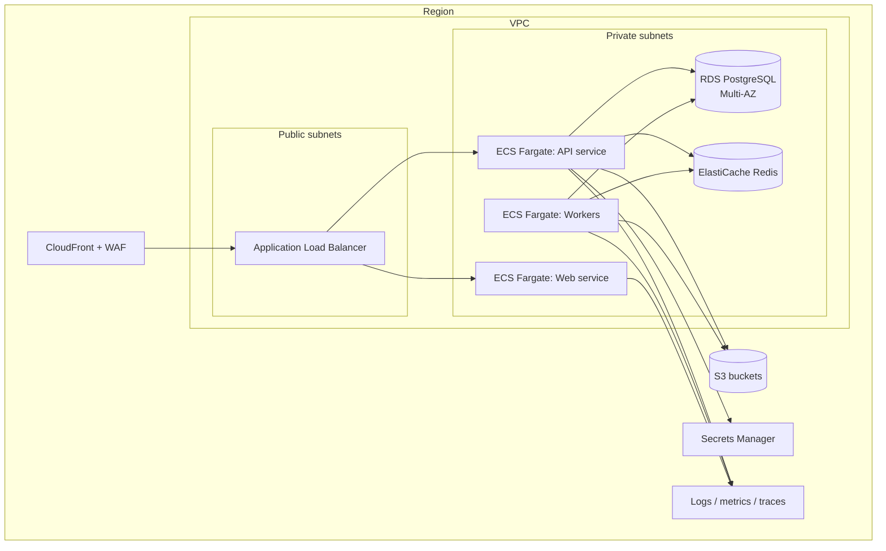

# Infrastructure and Deployment

> **Status:** Draft (proposed) · **Owner:** Tech Lead / DevOps · **Audience:** Engineers, DevOps

## 1. Environments

| Environment | Purpose | Data | Deploys |
|---|---|---|---|
| Local | Development | Seed data | Developer machine (Docker Compose) |
| Preview | Review a pull request | Seed data | Automatically per PR (optional, Phase 2) |
| Staging | Integration and QA, mirrors production | Anonymized/synthetic | Automatically on merge to `main` |
| Production | Customers | Real | Manual approval after staging checks |

## 2. Cloud layout (AWS, proposed)

- Containers run on **ECS Fargate** to avoid managing servers or Kubernetes at launch. Revisit when the team has dedicated platform engineers.
- **RDS PostgreSQL Multi-AZ** with automated backups and point-in-time recovery.
- All infrastructure defined in **Terraform** under `infra/`.

## 3. CI/CD pipeline (GitHub Actions)

```mermaid
flowchart LR
  pr[Pull request] --> lint[Lint + type check]
  lint --> test[Unit + integration tests]
  test --> sec[Security scans]
  sec --> build[Build images]
  build --> review[Code review approved]
  review --> merge[Merge to main]
  merge --> stg[Deploy to staging]
  stg --> e2e[E2E + smoke tests]
  e2e --> approve[Manual approval]
  approve --> prod[Deploy to production<br/>rolling / canary]
  prod --> smoke[Smoke tests + monitoring]
```

- Database migrations run as a separate step before the new version receives traffic. Migrations must be **backward compatible** (expand, then contract) so a rollback of the app never needs a rollback of the schema.
- Rollback = redeploy the previous image tag.

## 4. Backups and disaster recovery

| Item | Policy |
|---|---|
| Database | Continuous backup, point-in-time recovery for 35 days; daily snapshot copied to a second region |
| Object storage | Versioning enabled; cross-region replication for production |
| Restore test | Quarterly, documented |
| Targets | RPO ≤ 15 min, RTO ≤ 4 h |

## 5. Observability

| Signal | Tool (proposed) | Notes |
|---|---|---|
| Logs | CloudWatch Logs or Grafana Loki | Structured JSON, `requestId`, `tenantId`, no secrets or personal data |
| Metrics | Prometheus-compatible / CloudWatch | RED metrics per endpoint, queue depth, DB health |
| Traces | OpenTelemetry → Grafana Tempo / AWS X-Ray | Trace across API, workers and database |
| Errors | Sentry | Frontend and backend |
| Uptime | External synthetic checks | Public status page |

## 6. Alerting (starting set)

| Alert | Threshold | Severity |
|---|---|---|
| API error rate | > 2% for 5 min | SEV2 |
| API p95 latency | > 1 s for 10 min | SEV3 |
| Database CPU | > 80% for 15 min | SEV3 |
| Queue backlog | > 10,000 jobs or oldest > 10 min | SEV3 |
| Site down | Synthetic check fails twice | SEV1 |

## 7. Cost management

- Tags on every resource: `env`, `service`, `owner`.
- Monthly budget alerts.
- Monthly review of cost per tenant.
