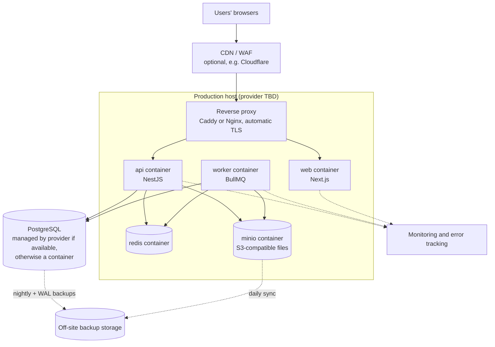

# Infrastructure and Deployment

> **Status:** Draft · **Owner:** Tech Lead / DevOps · **Audience:** Engineers, DevOps
> **MVP decision:** no AWS. Everything runs as Docker containers on a provider-neutral host ([ADR-0005](adr/0005-mvp-hosting-without-aws.md)).

## 1. Environments

| Environment | Purpose | Data | Deploys |
|---|---|---|---|
| Local | Development | Seed data | Developer machine (Docker Compose) |
| Staging | Integration and QA, mirrors production | Synthetic | Automatically on merge to `main` |
| Production | Customers | Real | Manual approval after staging checks |
| Preview (later) | Review a pull request | Seed data | Per PR, once the team grows |

## 2. MVP hosting layout

- **Start small:** one production server (e.g. 4 vCPU / 8 GB RAM) plus managed PostgreSQL, and a smaller staging server.
- **Scale up first, then out:** add CPU/RAM, then run several `api` and `worker` replicas behind the proxy.
- Server setup is scripted (for example Ansible or a cloud-init script) and kept in `infra/`, so a server can be rebuilt from scratch.

## 3. CI/CD pipeline (GitHub Actions)

```mermaid
flowchart LR
  pr[Pull request] --> checks[Lint, type check,<br/>unit + integration tests,<br/>security scans]
  checks --> review[Code review approved]
  review --> merge[Merge to main]
  merge --> build[Build Docker images<br/>push to GitHub Container Registry]
  build --> stg[Deploy to staging<br/>docker compose pull && up -d]
  stg --> e2e[E2E + smoke tests]
  e2e --> approve[Manual approval]
  approve --> prod[Deploy to production]
  prod --> smoke[Smoke tests + monitoring]
```

- Images are tagged with the commit SHA and stored in **GitHub Container Registry**.
- Deploy = SSH (or the platform's deploy hook) → `docker compose pull` → run migrations → `docker compose up -d`.
- Migrations must be **backward compatible** (expand, then contract), so rolling back the app never needs a schema rollback.
- Rollback = redeploy the previous image tag.

## 4. Backups and disaster recovery

| Item | MVP policy |
|---|---|
| Database | Provider's automated backups with point-in-time recovery if managed; otherwise nightly `pg_dump` + continuous WAL archiving (e.g. pgBackRest or WAL-G) to off-site storage |
| Files (MinIO) | Daily sync to off-site S3-compatible storage at a different provider/region |
| Server config | Scripted in `infra/`; no hand-made changes |
| Restore test | Monthly during MVP, documented |
| Targets | MVP: RPO ≤ 1 h, RTO ≤ 8 h. From Beta: RPO ≤ 15 min, RTO ≤ 4 h |

## 5. Observability (provider-neutral)

| Signal | Tool (proposed) | Notes |
|---|---|---|
| Logs | Grafana Loki (self-hosted or Grafana Cloud free tier) | Structured JSON, `requestId`, `tenantId`, no secrets or personal data |
| Metrics | Prometheus + Grafana | RED metrics per endpoint, queue depth, DB and host health |
| Traces | OpenTelemetry → Grafana Tempo | Added once the MVP is stable |
| Errors | Sentry (cloud or self-hosted) | Frontend and backend |
| Uptime | External checks (e.g. UptimeRobot / Better Stack) | Public status page |

## 6. Alerting (starting set)

| Alert | Threshold | Severity |
|---|---|---|
| Site down | Uptime check fails twice | SEV1 |
| API error rate | > 2% for 5 min | SEV2 |
| Backup job failed | Any failure | SEV2 |
| Disk usage | > 80% | SEV3 |
| API p95 latency | > 1 s for 10 min | SEV3 |
| Queue backlog | Oldest job > 10 min | SEV3 |
| TLS certificate | Expires in < 14 days | SEV3 |

## 7. Availability targets

| Phase | Target | Why |
|---|---|---|
| MVP (pilots) | 99.5% monthly | Single server; pilots are told about planned maintenance |
| Beta onward | 99.9% monthly | Requires redundancy (second app server, managed DB with standby); see ADR-0005 revisit triggers |

## 8. Moving to a larger cloud later

Because the code uses only portable interfaces (S3 API, PostgreSQL, Redis, SMTP, env vars), moving to AWS, GCP or Azure is a hosting project: provision equivalents, restore the database, sync files, switch DNS. Write a new ADR that supersedes ADR-0005 when that happens.

## 9. Cost management

- Track monthly hosting cost per environment.
- Review cost per tenant monthly once there are paying customers.
