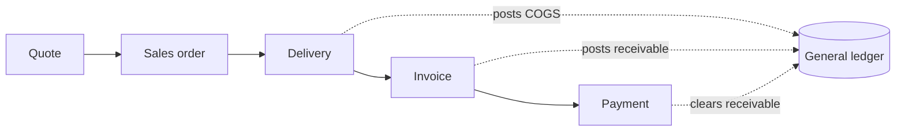

# Personas and User Journeys

> **Status:** Draft · **Owner:** Product / Design · **Audience:** Product, design, engineering, marketing, sales

Personas are based on assumptions until validated with customer interviews. Mark each one **Validated** once confirmed.

## Personas

### 1. Priya, Business Owner (decision maker, buyer)
- **Company:** 35-person wholesale distributor
- **Goals:** See cash, sales and stock at a glance; stop chasing staff for numbers.
- **Frustrations:** Reports are always late; tools don't talk to each other.
- **Uses:** Dashboard, reports, approvals on mobile browser.
- **What wins her:** Price, speed of setup, "one place for everything".

### 2. Ramesh, Finance Manager (power user, key influencer)
- **Goals:** Close the month in days, not weeks; stay compliant; trust the numbers.
- **Frustrations:** Manual reconciliations, copying data from sales spreadsheets.
- **Uses:** Journals, invoices, bills, bank reconciliation, tax and financial reports.
- **What wins him:** Accurate double-entry, audit trail, accountant-friendly exports.

### 3. Sita, Operations / Warehouse Manager
- **Goals:** Never run out of best sellers; know exactly what is where.
- **Frustrations:** Stock counts never match; transfers are untracked.
- **Uses:** Stock movements, transfers, reorder alerts, purchase orders.
- **What wins her:** Simple screens, barcode support, alerts.

### 4. Arjun, Sales Representative
- **Goals:** Send quotes fast; know if stock is available; track his orders.
- **Frustrations:** Has to call the warehouse to check stock.
- **Uses:** Customers, quotes, sales orders.
- **What wins him:** Speed, real-time stock, quote templates.

### 5. Maya, HR Manager (Phase 3)
- **Goals:** Run payroll correctly and on time; handle leave without email chains.
- **Uses:** Employees, leave, attendance, payroll.

### 6. Tenant Administrator (often the owner or an IT-minded staff member)
- **Goals:** Set up the company, add users, control who sees what.
- **Uses:** Setup wizard, users and roles, settings, integrations, billing.

## Key user journeys

### J1. Sign up to first invoice (activation journey)
1. Owner signs up with email and verifies it.
2. Setup wizard: company name, country, currency, fiscal year, industry template.
3. Chart of accounts and tax rates are created from the template.
4. Owner imports customers and products from CSV (or adds them manually).
5. Owner invites finance and sales users and assigns roles.
6. Sales rep creates a quote, converts it to an order, then to an invoice.
7. Invoice is emailed to the customer as a PDF.
**Success:** done within the first day, with no support ticket.

### J2. Order to cash
Quote → Sales order (stock reserved) → Delivery (stock decreases, cost of goods sold posted) → Invoice (receivable posted) → Payment received (receivable cleared) → Reports updated.

### J3. Procure to pay (Phase 2)
Purchase requisition → Approval → Purchase order → Goods receipt (stock increases) → Supplier bill (three-way match) → Payment made.

### J4. Month-end close
Bank reconciliation → Review unposted documents → Accruals and adjustments → Review trial balance → Generate P&L and balance sheet → Lock period.

### J5. Hire to payroll (Phase 3)
Employee created → Leave and attendance recorded → Payroll run calculated → Reviewed and approved → Payslips issued → Payroll journal posted to finance.

